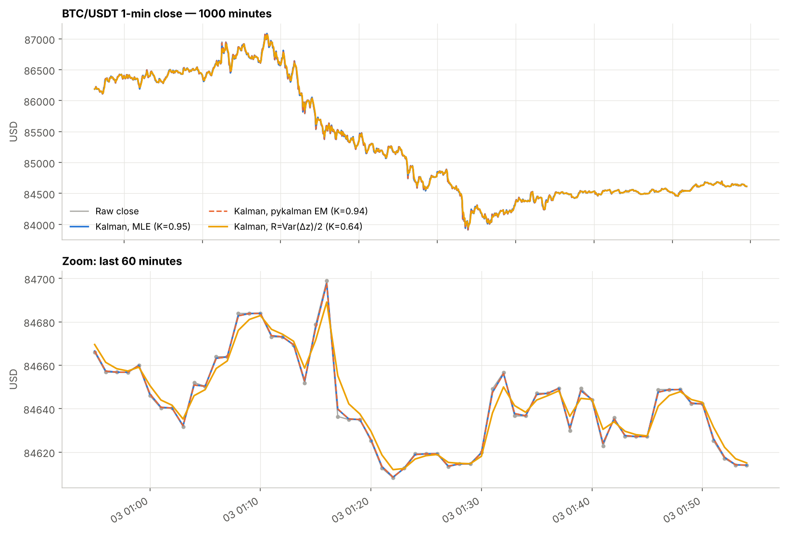
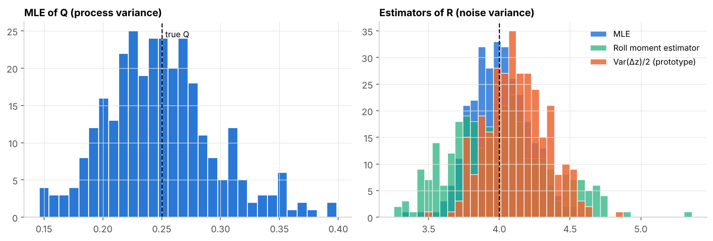
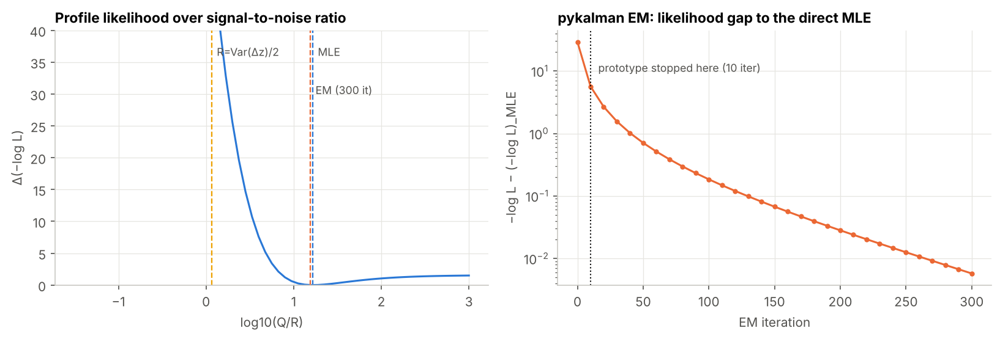
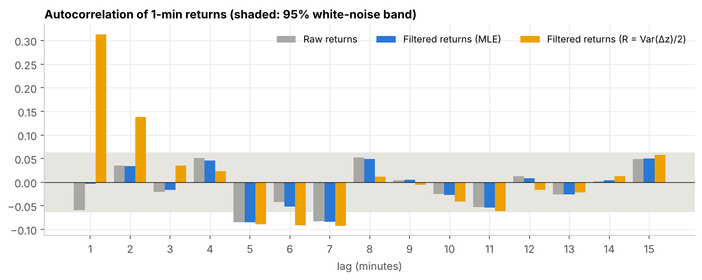
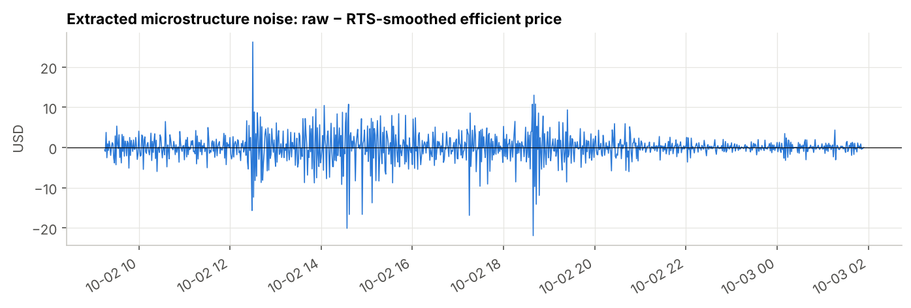

# Kalman Filter for Market Microstructure Noise

Separating the **efficient price** from **microstructure noise** (bid-ask bounce,
price discreteness, latency) in high-frequency BTC/USDT data with a local-level
state-space model, a hand-written Kalman filter, and maximum-likelihood
calibration, benchmarked against `pykalman`'s EM algorithm.

The problem is the same one gravitational-wave searches solve: pull a weak,
structured signal out of a noisy detector stream, with the noise model learned
from the data.



## Model

Log-price in basis points, $z_t = 10^4 \ln P_t$:

$$
\begin{aligned}
x_t &= x_{t-1} + w_t, & w_t &\sim \mathcal N(0, Q) &&\text{(efficient price: random walk)}\\
z_t &= x_t + v_t,     & v_t &\sim \mathcal N(0, R) &&\text{(observed price = efficient + noise)}
\end{aligned}
$$

| Step | Equation |
|---|---|
| Predict | $\hat x_{t\mid t-1} = \hat x_{t-1\mid t-1}$, $P_{t\mid t-1} = P_{t-1\mid t-1} + Q$ |
| Gain | $K_t = P_{t\mid t-1} / (P_{t\mid t-1} + R)$ |
| Update | $\hat x_{t\mid t} = \hat x_{t\mid t-1} + K_t (z_t - \hat x_{t\mid t-1})$, $P_{t\mid t} = (1-K_t) P_{t\mid t-1}$ |
| Likelihood | $-\log L = \tfrac12 \sum_t \left[\log 2\pi F_t + v_t^2 / F_t\right]$, $F_t = P_{t\mid t-1} + R$ |

In steady state the gain depends only on the signal-to-noise ratio $q = Q/R$:
$K_\infty = \tfrac12\left(-q + \sqrt{q^2 + 4q}\right)$. The filter is then
exactly an EWMA with $\alpha = K_\infty$, and $q$ decides how much the filter
trusts the new trade versus its own prediction.

## Results

### 1. Synthetic data with known ground truth (`scripts/01_synthetic_validation.py`)

Over 300 Monte-Carlo paths of 1000 observations ($Q = 0.25$, $R = 4$):

| Estimator | Q | R |
|---|---|---|
| **MLE** | 0.249 ± 0.046 | 4.002 ± 0.196 |
| Roll moment estimator ($R = -\mathrm{Cov}(\Delta z_t, \Delta z_{t-1})$) | – | 4.005 ± 0.346 |
| $R = \mathrm{Var}(\Delta z)/2$ (prototype heuristic) | – | 4.130 ± 0.212, biased by $+Q/2$ |

The MLE is unbiased. The filtered estimate halves the RMSE versus the truth
(2.04 to 0.97), and the RTS smoother brings it to 0.77.



### 2. BTC/USDT, 1-minute closes (`scripts/02_btc_benchmark.py`)

These are 1000 minutes of Binance closes (2026-10-02 09:15 to 2026-10-03 01:54
UTC, bundled in `data/`). Units are bps² per minute.

| Method | Q | R | Q/R | $K_\infty$ | −log L | Var. red. | ACF₁ filtered |
|---|---:|---:|---:|---:|---:|---:|---:|
| **Manual MLE (Q, R free)** | 26.68 | 1.62 | 16.5 | 0.946 | **3113.48** | 10.8 % | −0.003 |
| Constrained MLE, R = Roll | 26.43 | 1.76 | 15.0 | 0.941 | 3113.49 | 11.7 % | 0.002 |
| pykalman EM, 300 iter | 26.51 | 1.71 | 15.5 | 0.943 | 3113.48 | 11.4 % | 0.000 |
| pykalman EM, 10 iter *(prototype)* | 22.03 | 4.78 | 4.6 | 0.845 | 3119.13 | 28.0 % | 0.102 |
| Constrained MLE, R = Var(Δz)/2 *(prototype)* | 17.32 | 14.94 | 1.2 | 0.643 | 3178.88 | 54.2 % | **0.313** |

For comparison, the lag-1 autocorrelation of the raw returns is −0.059, the
bid-ask-bounce signature.

**Findings**

* **About 11 % of 1-minute return variance is microstructure noise**
  ($2R / \mathrm{Var}(\Delta z)$). The direct MLE, the Roll moment estimator and
  a fully converged EM all agree on this.
* **The filtered returns are white.** The negative lag-1 autocorrelation of the
  raw returns (−0.059) goes to about 0, as the model predicts: the filtered
  increments are $K v_t$, and the innovations $v_t$ are white under a correct
  model.
* **There is no lag.** The filter is in phase with the price (0 min lag),
  while a 10-minute SMA trails it by about 4 minutes.
* **The original "overfitting" diagnosis was wrong.** In the first prototype the
  manual MLE gave a much higher Q/R than pykalman, and the conclusion at the
  time was that the MLE was overfitting by driving R to 0. In fact pykalman's
  EM had stopped after 10 iterations, far from convergence. EM converges
  linearly and needs about 300 iterations to reach the MLE
  ([likelihood plot](figures/btc_likelihood.png), right). The "fix" adopted
  then, fixing $R = \mathrm{Var}(\Delta z)/2$, assumes $Q = 0$. It is rejected
  by 65 nats of log-likelihood and makes the filter *lag*: the filtered returns
  pick up a +0.31 lag-1 autocorrelation. Its "54 % variance reduction" is
  over-smoothing, not noise removal.
* **The model is not perfect.** The innovations fail Ljung–Box (p ≈ 0.009) and
  the extracted noise is clearly heteroskedastic (below). Constant (Q, R) is a
  first approximation; see *Next steps*.





## Repository layout

```
src/kfnoise/
  filter.py         # Kalman filter, RTS smoother, exact likelihood, MLE,
                    # constrained MLE, Roll estimator, profile likelihood
  pykalman_impl.py  # library benchmark (EM)
  data.py           # synthetic generator, ccxt / Binance public-API loaders, CSV sample
  metrics.py        # variance reduction, ACF, Ljung-Box, lag vs. SMA
  plotting.py       # shared figure style
scripts/
  01_synthetic_validation.py
  02_btc_benchmark.py
legacy/
  gemini_original.py  # the first prototype, kept for provenance and to reproduce its numbers
tests/                # pytest: parameter recovery, closed-form gain, exact match with pykalman
data/btcusdt_1m_sample.csv
figures/, results/    # generated outputs
```

## Quick start

```bash
pip install -r requirements.txt
pytest -q                                          # 10 tests
python scripts/01_synthetic_validation.py          # ~10 s
python scripts/02_btc_benchmark.py --source csv    # reproduce the table above (~1 min, EM dominates)
python scripts/02_btc_benchmark.py                 # live data (ccxt -> Binance public mirror -> CSV fallback)
python legacy/gemini_original.py                   # original prototype on the same data
```

## Changes from the first prototype

| Prototype | Now | Why |
|---|---|---|
| Filter on raw USD prices, $P_0 = 1$ | log-price in bps, diffuse prior | The model is defined on log-prices, and $P_0 = 1$ is meaningless when $P \approx 8.6\times10^4$ |
| Likelihood includes the first innovation | first innovation dropped | It is dominated by the arbitrary prior |
| `kf.em(n_iter=10)` | 300 iterations, with the convergence tracked | EM had not converged, which explained the Q/R disagreement |
| Comment says "smooth", code calls `filter` | explicit `smooth=` flag, plus our own RTS smoother | causal vs. acausal (look-ahead) must be explicit |
| $R = \mathrm{Var}(\Delta z)/2$ | Roll estimator $R = -\gamma_1$ (old heuristic kept as an option) | $\mathrm{Var}(\Delta z) = Q + 2R$, so the old estimate is biased by $Q/2$ |
| Plot only | variance reduction, ACF, Ljung–Box, lag vs. SMA, profile likelihood | "A physicist shows a plot; a quant shows a metric" |

## Next steps

* Rolling or online MLE (re-fit Q, R every N minutes) or a GARCH-type Q for the
  heteroskedasticity visible above.
* Tick or order-book data instead of 1-minute closes. Noise dominates at higher
  frequency, which is where the filter matters most.
* Student-t observation noise for jumps (robust Kalman).
* Use the filtered price for a simple mean-reversion signal and measure the
  out-of-sample P&L after costs.

## License

MIT
